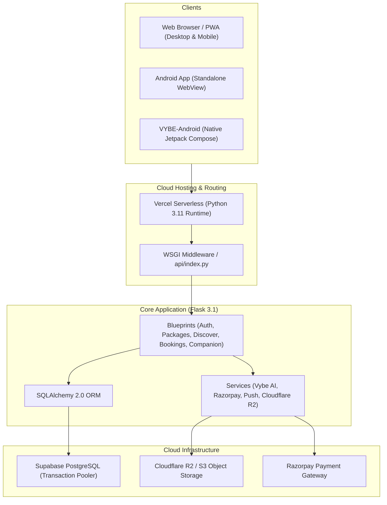

# VYBE — Travel Marketplace

> **Your mood. Your trip. Your VYBE.**  
> *Find trips that match your vibe.*

[](https://www.python.org/)
[](https://flask.palletsprojects.com/)
[](https://supabase.com/)
[](https://vercel.com/)
[](https://developer.android.com/)
[](tests/)

---

## 🌟 Overview

**VYBE** is an AI-powered travel discovery and marketplace platform designed to revolutionize how modern travelers explore, plan, and book travel experiences. Instead of tedious search filters and endless text reviews, VYBE delivers an interactive, vibe-centric experience:

- **Swipe-Based Travel Discovery**: A Tinder/Bumble-inspired card-swiping interface tailored to traveler moods, travel styles (adventure, luxury, budget, relaxation), and destination preferences.
- **Intelligent AI Companion**: Personalized travel companion and itinerary planner providing deterministic packing advice, safety checklists, and trip recommendations.
- **TruePrice Cost Transparency**: Full transparent breakdowns of accommodation, guided tours, flights, and hidden fees upfront.
- **Verified Operator Marketplace**: Tour companies submit government identification and credentials for admin verification before publishing packages.
- **End-to-End Booking Lifecycle**: From initial traveler inquiry and bespoke operator quotations to Razorpay payment signature verification and trip management.
- **Cloud-Native & Untethered Mobile Access**: Fully deployed on Vercel serverless architecture backed by Supabase PostgreSQL, accessible via any modern browser or the standalone Android app.

---

## 🌐 Live Deployments

| Component | Platform / URL | Status |
| :--- | :--- | :--- |
| **Production Web** | [https://vybe-travel-marketplace.vercel.app](https://vybe-travel-marketplace.vercel.app) | 🟢 Live |
| **Android Client** | Standalone APK (`android/app/build/outputs/apk/debug/app-debug.apk`) | 🟢 Untethered |
| **Database** | Supabase Cloud PostgreSQL (Transaction Pooler `port 6543`) | 🟢 Configured |
| **Object Storage** | Cloudflare R2 / AWS S3 S3-compatible storage | 🟢 Integrated |

---

## 🏗️ Architecture



---

## 📁 Repository Structure

```text
VYBE/
├── .env.example             # Safe environment variable configuration template
├── .gitignore               # Production-hardened ignore rules for git
├── .vercelignore            # Serverless deployment bundle optimization
├── README.md                # Project documentation
├── app.py                   # Flask application factory, routes, and WSGI middleware
├── config.py                # Configuration classes (Development, Production, Vercel)
├── gunicorn.conf.py         # Production WSGI server configuration (for containers)
├── render.yaml              # Render PaaS configuration blueprint
├── requirements.txt         # Core Python dependencies
├── run.bat                  # Windows 1-click developer setup & launcher
├── seed.py                  # Database seed script for travel packages & demo users
├── vercel.json              # Vercel serverless routing & function specifications
├── wsgi.py                  # Generic WSGI entry point
│
├── android/                 # Standalone Android mobile client (WebView hybrid)
│   ├── app/src/main/        # AndroidManifest, Java sources, assets, layouts
│   └── gradlew.bat          # Gradle build wrapper
│
├── VYBE-Android/            # Alternative Native Kotlin + Jetpack Compose Android client
│
├── api/
│   └── index.py             # Vercel serverless function entrypoint
│
├── data/
│   ├── sample_packages.json # Seed travel packages with coordinates, tags, and pricing
│   ├── more_packages.json   # Extended catalog of regional trips
│   └── singapore.json       # AI companion curated destination database
│
├── docs/                    # Architecture, deployment, and security guides
│   ├── audit_report.md
│   ├── database_migration_guide.md
│   ├── google_play_release_readiness.md
│   └── vercel_supabase_deployment_guide.md
│
├── migrations/              # Supabase PostgreSQL DDL migration scripts
│   ├── supabase_clean_setup.sql     # Master clean idempotent schema
│   └── supabase_complete_schema.sql # Self-healing schema migration
│
├── models/                  # SQLAlchemy 2.0 Database Models
│   ├── user.py              # Travelers, Operators, Admins
│   ├── package.py           # Travel packages, itineraries, TruePrice breakdown
│   ├── booking.py           # Booking requests, states, and payments
│   ├── company.py           # Operator verification and business profiles
│   ├── companion.py         # AI companion sessions, packing lists, checklists
│   ├── custom_offer.py      # Bespoke operator proposals & price negotiation
│   ├── interaction.py       # Swipe records (Like, Pass, Save, Book)
│   ├── messaging.py         # Inquiries and real-time chat messages
│   ├── notification.py      # System and push notifications
│   ├── review.py            # Package reviews and ratings
│   ├── moderation.py        # Admin flags, audit logs, and account suspensions
│   └── audit.py             # Security audit logs
│
├── routes/                  # Modular Flask blueprints
│   ├── auth.py              # Authentication, registration, password reset
│   ├── traveler.py          # Onboarding, user dashboard, saved packages
│   ├── packages.py          # Package browsing, filtering, details
│   ├── main.py              # Homepage, discovery swipe API
│   ├── bookings.py          # Booking lifecycle & Razorpay payment verification
│   ├── operator.py          # Operator portal, package authoring, verification
│   ├── admin.py             # Administrative moderation and dispute handling
│   ├── companion.py         # AI Singapore companion and trip planning
│   ├── messaging.py         # Traveler-operator inquiries and chat
│   ├── notifications.py     # Notification polling & push token registration
│   └── reports.py           # Safety reports and user flags
│
├── scripts/                 # Developer support & maintenance scripts
│   ├── adb_tunnel_daemon.ps1   # Optional ADB reverse port forwarding daemon
│   ├── migrate_to_supabase.py # SQLite-to-PostgreSQL data exporter
│   ├── run_mobile_dev.bat     # Local USB development launcher (Windows)
│   └── run_mobile.ps1         # Local USB development launcher (PowerShell)
│
├── services/                # Business logic services
│   ├── vybe_ai.py           # AI recommendation scoring & match explainability
│   ├── sg_companion.py      # Destination companion & itinerary engine
│   ├── payment.py           # Razorpay client & webhook signature verification
│   ├── storage.py           # Cloudflare R2 / AWS S3 media uploads
│   ├── push.py              # Web push & FCM notification dispatch
│   └── auth_tokens.py       # Cryptographic token generator
│
├── static/                  # Frontend assets
│   ├── css/style.css        # Responsive custom CSS design system
│   ├── js/                  # Client-side scripts (main.js, discover.js)
│   ├── icons/               # PWA app icons (192x192, 512x512 maskable)
│   ├── images/              # Package photography and brand badges
│   ├── manifest.webmanifest # Progressive Web App manifest
│   └── sw.js                # Service Worker for offline asset caching
│
├── templates/               # Jinja2 HTML templates
└── tests/                   # Pytest automated test suite (98 tests)
```

---

## 🚀 Quick Start for Collaborators

### 1. Prerequisites
- **Python 3.11+** installed on PATH.
- **Git** installed.
- (Optional) **Android Studio** for mobile app development.

### 2. Local Setup (5 Minutes)

#### Windows (1-Click Launch)
Simply double-click [`run.bat`](file:///d:/Projects/VYBE/run.bat) in the repository root.  
It automatically:
1. Detects Python.
2. Creates the `.venv` virtual environment if missing.
3. Installs dependencies from `requirements.txt`.
4. Initializes the local database and seeds sample travel data.
5. Starts the Flask server at `http://127.0.0.1:5000`.

#### Manual Setup (Windows / macOS / Linux)
```bash
# 1. Clone repository
git clone https://github.com/TheCrazyDabi/vybe-travel-marketplace.git
cd vybe-travel-marketplace

# 2. Create and activate virtual environment
python -m venv .venv

# On Windows:
.venv\Scripts\activate
# On macOS / Linux:
source .venv/bin/activate

# 3. Install dependencies
pip install -r requirements.txt

# 4. Configure environment
cp .env.example .env

# 5. Seed database with travel packages
python seed.py

# 6. Run local server
python app.py
```
Open **`http://localhost:5000`** in your browser.

---

## 📱 Mobile App Setup & Testing

### Option A: Direct APK Installation (Fastest)
The repository includes a ready-to-install debug APK located at:
```text
android/app/build/outputs/apk/debug/app-debug.apk (~6.3 MB)
```
- Send this APK to any Android phone.
- Tap to install (allow "Install unknown apps").
- The app connects directly to the live production Vercel cloud backend over Wi-Fi or mobile data. No USB cable or computer connection required!

### Option B: Build APK with Android Studio
1. Open the `android/` directory in Android Studio.
2. Let Gradle sync dependencies.
3. Run `./gradlew.bat assembleDebug` or click **Run ▶** to install directly to a connected phone.

---

## 🧪 Testing & Quality Assurance

VYBE maintains a rigorous test suite of **98 automated tests** covering role-based security, booking concurrency, idempotency, Razorpay verification, and AI companion logic:

```bash
# Run the full test suite
pytest -q
```

```text
============================== 98 passed in 104.14s ==============================
```

Test coverage includes:
- `tests/test_basic.py` — Health endpoints, security headers, routing.
- `tests/test_booking_workflow.py` — Capacity reservation, cancellation rollback, concurrency.
- `tests/test_companion.py` — Singapore AI companion and deterministic recommendations.
- `tests/test_discover_flow.py` — Swipe decisions, undo mechanics, match reasons.
- `tests/test_play_store_readiness.py` — Account deletion, privacy policy, security endpoints.
- `tests/test_production_services.py` — Razorpay HMAC validation, Cloudflare R2 uploads, push notifications.
- `tests/test_roles.py` — Role-based access controls (Traveler, Operator, Admin).

---

## 🔐 Environment Variables

| Variable | Description | Default (Dev) |
| :--- | :--- | :--- |
| `SECRET_KEY` | Flask session and CSRF encryption key | Auto-generated dev fallback |
| `DATABASE_URL` | Supabase / PostgreSQL or SQLite connection URI | `sqlite:///instance/vybe.db` |
| `FLASK_ENV` | Environment mode (`development` / `production`) | `development` |
| `RAZORPAY_KEY_ID` | Razorpay public key for client checkout | Mock / test mode |
| `RAZORPAY_KEY_SECRET` | Razorpay private secret for webhook HMAC | Mock / test mode |
| `R2_ACCESS_KEY_ID` | Cloudflare R2 / S3 access key ID | Local storage fallback |
| `R2_SECRET_ACCESS_KEY`| Cloudflare R2 / S3 secret access key | Local storage fallback |
| `R2_BUCKET_NAME` | Cloudflare R2 bucket name | `vybe-uploads` |

---

## 👥 Contributing & Team Workflow

1. **Main Branch Protection**: The `main` branch is always runnable and automatically deployed to Vercel upon pushing.
2. **Feature Commits**: Commit changes with descriptive messages:
   ```bash
   git add .
   git commit -m "feat(discover): add swipe sound effects"
   git push origin main
   ```
3. **Automated Deployment**: Pushing to `origin/main` automatically triggers Vercel to rebuild and update the production website within 30 seconds.
4. **Mobile Instant Updates**: Because the Android app loads the live cloud URL, web UI updates and backend fixes appear immediately in the mobile app without reinstalling the APK!

---

## 📄 License
This project is developed for hackathon presentation and portfolio use. All rights reserved.
